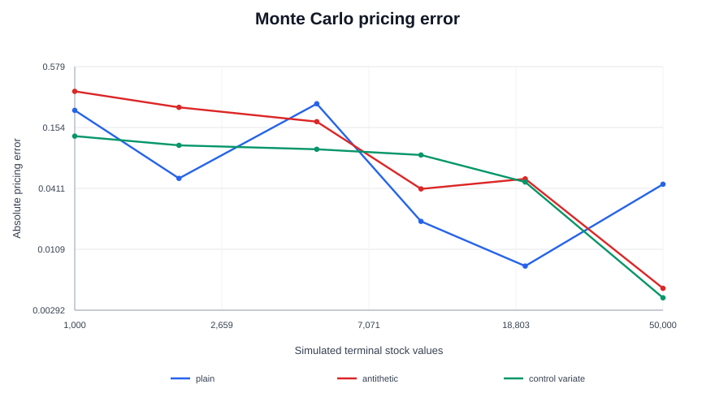
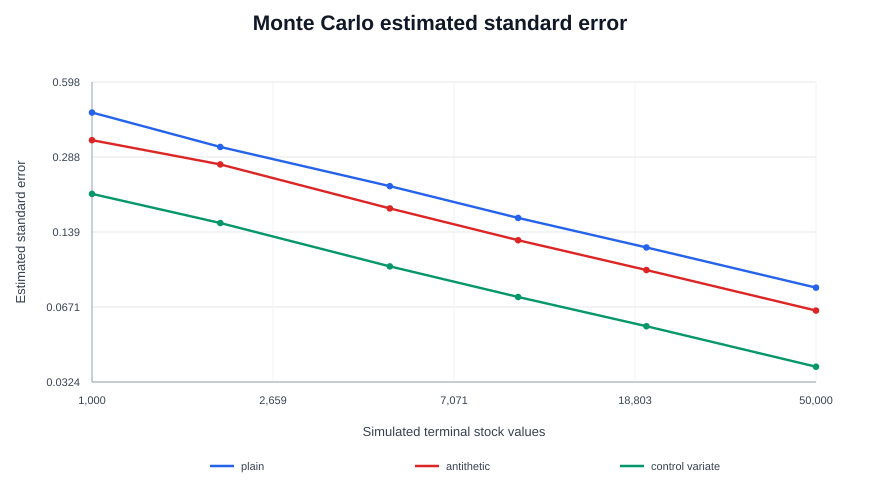

# Options Pricing and Hedging Lab

A small quantitative-finance project focused on European option pricing, Monte Carlo estimation, and model validation.

This first version covers option pricing and statistical checks. A discrete delta-hedging experiment is planned as a follow-up.

## What's in here

- Black-Scholes prices for European calls and puts (no dividends).
- Delta, Gamma, Vega and Theta.
- Plain Monte Carlo, antithetic variates and a control variate.
- Standard errors, approximate 95% confidence intervals and convergence plots.
- Unit tests for pricing identities, Greeks and repeatability.

## Setup

```bash
python3 -m venv .venv
source .venv/bin/activate
python -m pip install -r requirements.txt
```

On Windows, activate the environment with `.venv\\Scripts\\activate` instead.

## Run it

```bash
python run_day1.py
python -m pytest -q
```

The script prints the baseline option price and Greeks, then saves results and plots in `results/`.

## Baseline setup

The example uses an at-the-money European call with:

| Input | Value |
|---|---:|
| Stock price | 100 |
| Strike | 100 |
| Time to expiry | 1 year |
| Risk-free rate | 3% |
| Volatility | 25% |

The Black-Scholes call price is approximately `11.348477`.

## Results from the Day 1 run

The CSV files contain the estimator outputs, estimated standard errors and confidence intervals:

- [Monte Carlo comparison](results/monte_carlo_comparison.csv)
- [Convergence experiment data](results/mc_convergence.csv)

The plots below show one random seed per path count. They're useful for inspecting the behaviour, but one run isn't enough to rank methods reliably.





## Methods

Plain Monte Carlo averages discounted option payoffs from simulated terminal stock prices.

Antithetic variates use pairs of normal draws `z` and `-z`. Control variates use the discounted terminal stock price, whose expected value is the current stock price in this model.

The confidence intervals use a normal approximation. The convergence plots use one seed at each path count, so absolute error can jump around. These plots are a first look, not enough to claim one method is always better. A repeated-seed comparison should be used before drawing that conclusion.

## Assumptions and limits

The model uses risk-neutral geometric Brownian motion, a constant interest rate, constant volatility, European exercise and no dividends. It does not use real market data and should not be treated as a trading strategy. Transaction costs, calibration, early exercise and stochastic volatility are not part of this first version.

## Questions to investigate next

1. Which estimator has the lowest standard error for this option and path budget?
2. Does the result hold across many independent seeds?
3. How do hedge frequency and transaction costs change hedging P&L?
